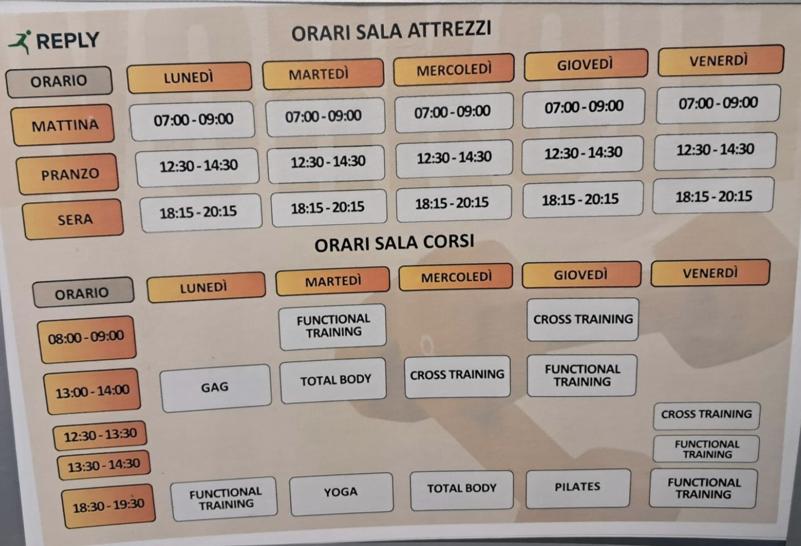

# Orari della palestra

Fonte: foto dell'avviso affisso in palestra, salvata in
[orari-palestra-2026-11.png](orari-palestra-2026-11.png). Il portale Sportrick resta la fonte
di verita' per disponibilita' e orari reali (`GetActivitySchedule`): questa tabella serve per
orientarsi e per validare le preferenze del bot. Se la foto cambia, aggiornare
`lambda_function/timetable.py` (`GYM_SLOTS`, `COURSES`), la tabella e questa data.

## Sala attrezzi (lunedi' - venerdi')

| Fascia | Orario | Inizio usato dal bot |
|---|---|---|
| Mattina | 07:00 - 09:00 | `07:00` |
| Pranzo | 12:30 - 14:30 | `12:30` |
| Sera | 18:15 - 20:15 | `18:15` |

## Sala corsi

| Orario | Lun | Mar | Mer | Gio | Ven |
|---|---|---|---|---|---|
| 08:00 - 09:00 | | Functional Training | | Cross Training | |
| 12:30 - 13:30 | | | | | Cross Training |
| 13:00 - 14:00 | GAG | Total Body | Cross Training | Functional Training | |
| 13:30 - 14:30 | | | | | Functional Training |
| 18:30 - 19:30 | Functional Training | Yoga | Total Body | Pilates | Functional Training |

## Uso nel bot

- `/orari` mostra la griglia senza interrogare il portale.
- `/prefs` imposta, per giorno della lezione, gli orari della sala attrezzi in ordine di
  priorita' (vedi `docs/architecture/telegram-bot-aws.md`, sezione Preferenze e fallback).
